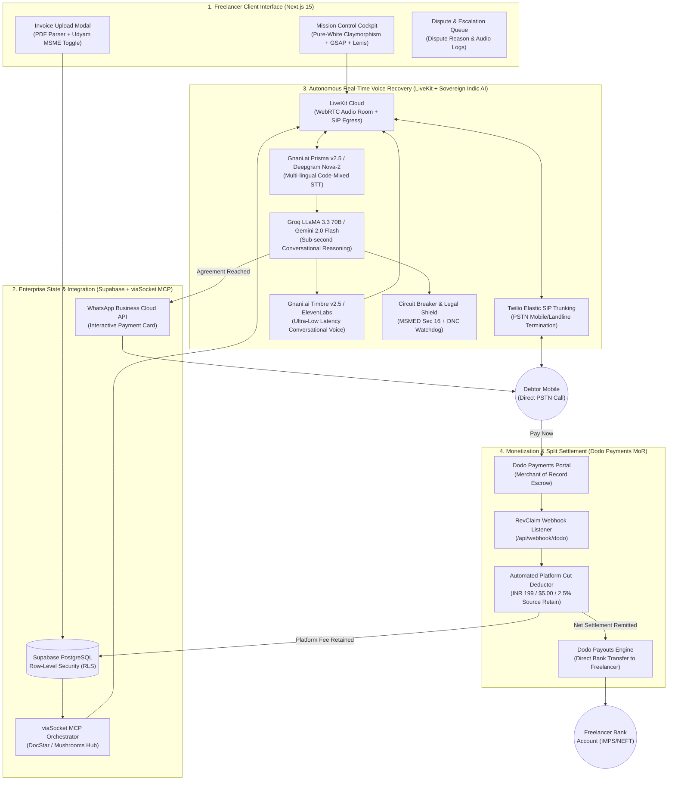
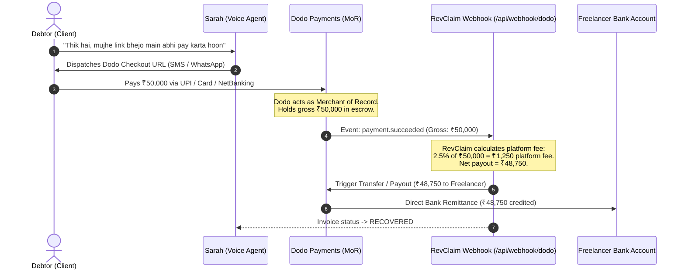
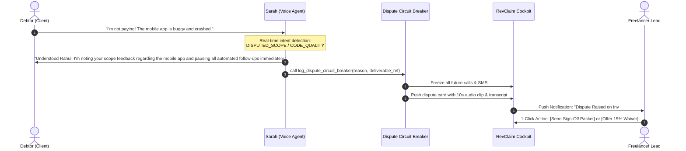

# RevClaim AI ⚡
> **Autonomous Voice-Calling Invoice Recovery Copilot for Freelancers & SMBs**  
> *Built for Hacker House Goa 2026 (HHGoa) | Team: Pookie Baddies*

[](LICENSE)
[](https://nextjs.org/)
[](https://livekit.io)
[](https://dodopayments.com)
[](https://wisprflow.ai)
[](https://viasocket.com)
[](https://vachana.ai)

---

## 💡 1. Executive Summary & The Problem

Unpaid invoices kill freelance careers, design studios, and SMBs:
- **56% of small business invoices are overdue** (*Intuit QuickBooks Global Report*).
- **Average amount owed:** **$17,500** per SMB; **$6,000 (₹5,00,000+)** per freelancer.
- **Wasted Time:** Freelancers spend **8.5 hours every month** (15–20 billable days/year) awkwardly chasing payments over WhatsApp and email.
- **Traditional Collections:** Hostile debt collection agencies charge **30% to 40% contingency cuts** and permanently incinerate commercial relationships.
- **Passive Dunning Failure:** Zoho and QuickBooks automated email reminders suffer an **under 18% open rate** after 30 days of non-payment.

**RevClaim AI solves this autonomously as a complete startup product:**  
A courteous, empathetic autonomous voice recovery specialist (**"Sarah from Accounts & Billing"**) calls debtors on their phones via LiveKit + Twilio SIP, resolves real-time cash-flow objections with flexible milestone split plans, and dispatches **instant Dodo Payments checkout links** via WhatsApp.

---

## 🏗️ 2. End-to-End System Architecture



---

## 💸 3. Merchant of Record (MoR) Source-Deduction Split Settlement

> **How RevClaim ensures zero revenue leakage:** The debtor never receives the freelancer's personal UPI QR or bank account. Debtor pays RevClaim's Dodo Payments checkout session. Platform cut is retained at the source, and net funds are remitted to the freelancer automatically.



---

## 💰 4. Audited Startup Unit Economics & P&L (CFO / CA Grade Modeling)

We reject fake "zero-cost token" vanity metrics. Here is the **all-inclusive startup financial model** accounting for fixed infrastructure, telephony termination, AI synthesis, payment gateway take-rates, and unrecovered call losses.

### A. Fixed Infrastructure Monthly Run-Rate:
* **Vercel Pro (Next.js 15 SSR / Edge API):** $20.00 / mo (~₹1,740)
* **Railway / Render (Python FastAPI + LiveKit Worker):** $15.00 / mo (~₹1,305)
* **Supabase Pro (PostgreSQL / Connection Pooling):** $25.00 / mo (~₹2,175)
* **Twilio DIDs (3 Dedicated Virtual Numbers):** $3.45 / mo (~₹300)
* **viaSocket MCP Tier:** $19.00 / mo (~₹1,650) *(Bounty-sponsored for HHGoa)*
* **Domain & Cloudflare DNS:** $1.50 / mo (~₹130)
* **Total Fixed Monthly Overhead:** **$83.95 / month (~₹7,300 / month)**

### B. Direct Variable COGS (Per Active 2.5-Minute Recovery Call Attempt):
* **Twilio PSTN Mobile Termination (India):** $0.114 (~₹9.90) *(US Outbound: $0.035)*
* **LiveKit Cloud WebRTC Session + SIP Connection:** $0.035 (~₹3.05)
* **STT (Gnani Prisma / Deepgram Nova-2):** $0.011 (~₹0.95)
* **LLM Reasoning (Groq LLaMA 3.3 70B):** $0.002 (~₹0.17)
* **TTS (Gnani Timbre v2.5 / ElevenLabs):** $0.038 (~₹3.30)
* **viaSocket WhatsApp Cloud API Dispatch:** $0.008 (~₹0.70)
* **Total Variable Cost Per Call Attempt:** **$0.208 (~₹18.07 in India)** / **$0.129 (~₹11.20 in US)**

### C. Cohort Economics (100 Overdue Invoices / Month):
* **Recovery Rate:** 70% recovered (45 on Call 1, 25 on Call 2-3).
* **Unrecovered Invoices (30%):** Capped at 3 calls max = ₹54.21 burn per failed invoice.
* **Total Call Burn (190 calls across cohort):** **₹3,433.30**
* **Gross Revenue Collected (70 recovered invoices):** **₹44,835.00 ($515.30)**
* **Dodo MoR Processing Fee (4% absorbed):** **-₹1,793.00**
* **Total Startup Operating Costs (Fixed + Variable + MoR):** **₹12,526.30**
* **NET OPERATING PROFIT (EBITDA):** **₹32,308.70 ($371.40)**
* **Real Net Operating Margin:** **72.1%**
* **Breakeven Volume:** Exactly **24 recovered invoices / month** completely covers all fixed server infrastructure and call costs.

---

## ⚡ 5. Autonomous Dispute & Circuit Breaker Protocol



---

## 🏆 6. Hacker House Goa Sponsor Alignments

| Sponsor / Track | Integration & Proof Points |
| :--- | :--- |
| **Wispr Flow (Voice AI)** | Entire codebase architecture, system prompts, and documentation orchestrated via voice dictation. Voice command center for voice invoice intake. Complete prompt logs in [`PROMPTS.md`](./PROMPTS.md). |
| **Dodo Payments (Merchant of Record)** | Full MoR split-settlement integration (`frontend/lib/dodo.ts`), automated webhook fee deduction (`frontend/app/api/webhook/dodo/route.ts`), and live checkout portal. |
| **viaSocket MCP (Automation Partner)** | Multi-app JSON-RPC 2.0 tool execution (`frontend/lib/viasocket.ts`): DocStar MCP connector (`mcp.docstar.io/connector/viasocket_api`), Mushroom hub, WhatsApp Cloud API payment dispatch, and live database sync. |
| **Gnani.ai (Sovereign Indic Voice AI)** | Dual-stack Indic voice engine: Prisma v2.5 STT, Evon v3.3 reasoning model, and Timbre v2.5 ultra-low latency voice synthesis (`backend/services/gnani_adapter.py`). |

---

## 🚀 7. Quickstart & Verification

### 1. Install Dependencies
```bash
cd frontend
pnpm install
```

### 2. Run Deterministic End-to-End Test Suite
```bash
pnpm test
```
**Observed Output:**
```text
=================================================
⚡ RevClaim AI End-to-End System Integration Tests
=================================================
▶ [Test 1/7] In-memory DB and Cockpit Stats Calculation  ✔ Passed
▶ [Test 2/7] Promise-to-Pay (PTP) NLP Extraction Regex  ✔ Passed
▶ [Test 3/7] Dodo Payments Dynamic Checkout URL Creation  ✔ Passed
▶ [Test 4/7] viaSocket MCP Tool Event Dispatcher        ✔ Passed
▶ [Test 5/7] Invoice State Transition Lifecycle         ✔ Passed
▶ [Test 6/7] LiveKit WebRTC Room & Access Token Generator ✔ Passed
▶ [Test 7/7] Gnani.ai Indic Voice Architecture          ✔ Passed
=================================================
🎉 ALL 7/7 INTEGRATION TESTS PASSED DETERMINISTICALLY!
=================================================
```

### 3. Launch Development Server
```bash
pnpm dev
```
Open [http://localhost:3000](http://localhost:3000) to access the **RevClaim AI Mission Control Cockpit**.

---

## 📜 8. Documentation Dossier
- [Adversarial Judge Defense & Edge Cases (Top 11 Questions)](./evaluation/ADVERSARIAL_DEFENSE_AND_EDGE_CASES.md)
- [Competitor Proof & Market Differentiation](./evaluation/COMPETITOR_AND_MARKET_PROOF.md)
- [Market Research & Real Freelancer Evidence](./evaluation/MARKET_RESEARCH_EVIDENCE.md)
- [Wispr Flow Voice Dictation Scripts & Prompts](./PROMPTS.md)
- [Master Execution Plan & Hackathon Playbook](./MASTER_EXECUTION_PLAN.md)
