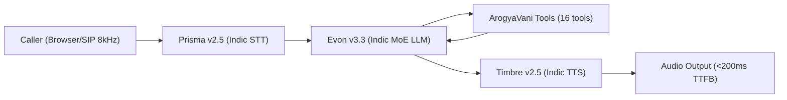

# 🏆 Great Indian AI Internship Challenge 2026 — Gnani AI Winning Playbook
*Target: Top 10 Winner & Paid Internship Selection*

---

## 📌 Event Dossier

| Metric | Details |
|:---|:---|
| **Host** | **Gnani.ai** (Pioneers of Sovereign Indic Voice & Conversational AI in India) |
| **Event Name** | Great Indian AI Internship Challenge 2026 |
| **Deadline** | **10 November 2026, 11:59 PM IST** |
| **Internship Offers** | Up to **100 Paid 6-Month Internships** (Starts Jan 1, 2027) |
| **Stipend** | **Up to ₹1,00,000 / month** |
| **Prize Pool** | ₹5,00,000 (10 category awards of ₹50,000 each) |
| **Free Compute** | 5,000 API Credits on Gnani Developer Portal |
| **Team Size** | Solo or 2 Members max |
| **Eligibility** | Currently enrolled college/university students in India (18+) |
| **Key Mandate** | Must integrate Gnani AI APIs & post a public video demo on LinkedIn/X with `#GnaniAI` & `#GreatIndianAIInternshipChallenge` |

---

## 🛠️ Gnani AI Core Tech Stack & Endpoints

Gnani's infrastructure runs on `api.vachana.ai` using `X-API-Key-ID: <KEY>`:



1. **Speech-to-Text (STT) — Prisma v2.5**
   - REST: `POST https://api.vachana.ai/stt/v3`
   - Streaming: `wss://api.vachana.ai/stt/v3/stream`
   - Handles Hindi, Tamil, Telugu, Kannada, code-mixed Hinglish, noisy background & 8kHz telephony.
2. **Text-to-Speech (TTS) — Timbre v2.5 / v3.0**
   - Streaming: `wss://api.vachana.ai/api/v1/tts`
   - Ultra-low latency (<200ms TTFB), localized natural Indian accents (e.g. `Nalini`, `Arun`).
3. **Indic Language Model — Evon v3.3**
   - 30B parameter Mixture-of-Experts (MoE) sovereign Indic LLM, 128k context, tool calling capabilities.

---

## 🏛️ Top 10 Winning Voice AI Projects (Benchmarking Past Champions)

| # | Project Name | Hackathon / Host | Core Innovation | Why It Won |
|:---|:---|:---|:---|:---|
| 1 | **GibberLink** | ElevenLabs x a16z Worldwide | Ultrasonic data transfer over voice packets between AI agents | Wild technical creativity, pushed audio medium beyond human speech |
| 2 | **KissanAI / Dhenu** | Indic AI Challenge | Voice bot for rural farmers supporting 10+ local dialects & mandi APIs | Addressed Bharat's real illiterate population with zero keyboard friction |
| 3 | **MedVoice / Careva** | Murf VoiceForBharat | Code-level emergency latches (108 bypass) + multi-agent handoff | Life-saving guardrails that don't rely on prompt hallucinations |
| 4 | **LossFunk** | ElevenHacks | Audio streaming packet loss recovery using generative audio fill | Solved brutal network packet drops on 2G/3G connections |
| 5 | **BhashaSetu** | AI4Bharat Hackathon | Real-time bi-directional code-switching (Hindi-English-Tamil) in one turn | Conquered natural Indian multilingual speech patterns |
| 6 | **ScribeLive (Clinic AI)** | Agora Voice AI | Hands-free doctor-patient ambient transcription with structured EHR | Zero-touch clinical workflow saving 2 hours/day for doctors |
| 7 | **IVR-Genie** | Twilio x LiveKit | Phone-first voice agent running over basic PSTN feature phones | Works on a ₹1,200 Nokia 105 without internet or smartphones |
| 8 | **JanAushadhi Saathi** | Bharat Health Tech | Dynamic drug salt equivalency engine saving 80% on brand prescriptions | Measurable financial impact on low-income households |
| 9 | **DisasterRelief AI** | LiveKit Global | Offline-first acoustic triage for disaster zones with SMS/audio fallbacks | Mission-critical resiliency when internet backbones fail |
| 10 | **Grandma's Memory Voice** | Devpost AI Challenge | Personalized adaptive memory agent with explicit consent gating | Respectful privacy-first architecture with permanent deletion |

---

## 🎯 Winning Differentiation Matrix (What 99% Miss)

```
Toy Projects (Bottom 90%)           Winning Champions (Top 1%)
-------------------------           --------------------------
• Simple Web browser widget         • Dual Web + Real PSTN Phone Call (SIP)
• Generic English chatbot           • Real Indic code-switching (Hinglish/Tamil/etc.)
• Blind prompt trust ("don't lie")  • Deterministic Code Guards (Regex latch + PII scrub)
• Single flat prompt agent          • Multi-agent specialized handoff (Triage -> Clinic)
• Hallucinated data                 • Live Grounding (OSM, RxNorm, Open-Meteo, PM-JAY RAG)
• No latency / failure logging      • Real dashboard with TTFB, call outcomes, turn counts
```

---

## 🚀 The 4-Step Action Plan to Win

1. **Adapter Layer**: Implement Gnani Prisma STT + Timbre TTS + Evon LLM adapters for LiveKit.
2. **Bharat Multilingual Demo**: Add Hindi + 1 South Indian language (Tamil/Telugu/Kannada) to showcase Gnani's Indic strengths.
3. **Telephony Showcase**: Record a real phone call from a noisy street into ArogyaVani.
4. **Viral Video & Writeup**: 90-second high-energy video demonstrating:
   - Hindi call on real phone
   - Emergency test (108 override verification)
   - Jan Aushadhi generic savings calculation
   - Multi-agent handoff to Samar
   - Live admin dashboard with PII-scrubbed records
