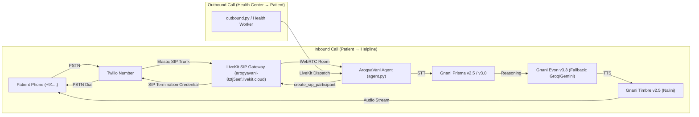

# 📞 Twilio SIP Telephony & Live Call Setup Guide
## ArogyaVani Sovereign Indic Voice AI Helpline

This guide details the complete configuration required to connect **Twilio Elastic SIP Trunking** to **LiveKit Cloud** and **ArogyaVani**, enabling real PSTN phone calls (+91 / +1) directly into the **Gnani AI voice pipeline** (Prisma STT + Evon LLM + Timbre TTS).

---

## 1. Telephony Architecture



---

## 2. Prerequisites

| Component | Source | Estimated Cost |
|:---|:---|:---|
| **Twilio Account** | [twilio.com/try-twilio](https://www.twilio.com/try-twilio) | Free trial ($15 credit) |
| **Twilio Phone Number** | Twilio Console → Phone Numbers | ~$1/month |
| **LiveKit Project** | `wss://arogyavani-8ztj5eef.livekit.cloud` | Already configured ✅ |
| **Gnani.ai API Key** | `vachana.ai` production key | Already configured ✅ |

---

## 3. Twilio Configuration Steps

### Step 1: Create an Elastic SIP Trunk
1. Log in to the [Twilio Console](https://console.twilio.com/).
2. Navigate to **Elastic SIP Trunking** → **Trunks** → **Create new SIP Trunk**.
3. Set Trunk Name: `ArogyaVani-LiveKit`.

### Step 2: Configure Origination (Inbound: PSTN Phone → LiveKit)
1. In your Trunk, click the **Origination** tab.
2. Click **Add Origination URI**:
   - **SIP URI:** `sip:arogyavani-8ztj5eef.livekit.cloud`
   - **Priority:** `10`
   - **Weight:** `10`
3. Click **Save**.

### Step 3: Configure Termination (Outbound: LiveKit → PSTN Phone)
1. Click the **Termination** tab.
2. Under **SIP URI**:
   - Enter your domain prefix, e.g.: `arogyavani`
   - Resulting Termination URI: `arogyavani.pstn.twilio.com`
3. Under **Authentication**:
   - Click **Create Credential List**.
   - **Credential List Name:** `arogyavani-sip-creds`
   - **Username:** `arogyavani_sip`
   - **Password:** `<Choose a strong password>`
4. Save the Credential List and assign it to the trunk.

### Step 4: Buy a Phone Number & Attach to Trunk
1. Go to **Phone Numbers** → **Manage** → **Buy a number**.
2. Select your country (+91 India or +1 US for testing).
3. Once purchased, navigate to **Elastic SIP Trunking** → **Trunks** → `ArogyaVani-LiveKit` → **Numbers**.
4. Click **Add a Number** and assign your purchased number.

---

## 4. LiveKit SIP Trunk Configuration

Install the LiveKit CLI if not already present:
```bash
# Windows (PowerShell)
irm https://get.livekit.io/cli.ps1 | iex
```

Authenticate with LiveKit Cloud:
```bash
lk cloud auth
# Or set LIVEKIT_URL, LIVEKIT_API_KEY, and LIVEKIT_API_SECRET in your shell
```

### Create Inbound Trunk
```bash
lk sip inbound create \
  --name arogyavani-inbound \
  --numbers "+91XXXXXXXXXX"
```

### Create Outbound Trunk
```bash
lk sip outbound create \
  --name arogyavani-outbound \
  --address arogyavani.pstn.twilio.com \
  --number "+91XXXXXXXXXX" \
  --auth-user "arogyavani_sip" \
  --auth-pass "<Your_SIP_Password>"
```
*Note the returned `SIPTrunkID` (starts with `ST_...`).*

---

## 5. Configure Backend `.env.local`

Update `backend/.env.local` with the outbound trunk ID and credentials:
```env
# Twilio SIP Telephony
SIP_OUTBOUND_TRUNK_ID=ST_xxxxxxxxxxxxxxxxxxxxxxxxxxxxxxxx
SIP_AUTH_USERNAME=arogyavani_sip
SIP_AUTH_PASSWORD=<Your_SIP_Password>

# Escalation notification phone (health worker receiving emergency alerts)
ESCALATION_ADMIN_PHONE=+919876543210
```

---

## 6. How to Run Live Calls

### Step 1: Start the ArogyaVani Voice Agent
In a terminal, start the agent service:
```bash
cd backend
uv run python src/agent.py dev
```

### Step 2: Placing an Outbound Call
To initiate an outbound health reminder call to any phone number:
```bash
cd backend
uv run python src/outbound.py +919876543210 --name "Ramesh" --reason "Blood pressure medicine follow-up"
```
The agent dials the phone via Twilio SIP trunk, greets the patient using **Gnani Timbre TTS (Nalini)**, and initiates two-way Hindi/English triage via **Gnani Prisma STT** and **Gnani Evon LLM**.

### Step 3: Inbound Calls
Simply dial your Twilio phone number from your mobile. Twilio routes the call via SIP Origination to LiveKit Cloud, which activates `my-agent`, answers the phone, and conducts the health conversation in real time.

---

## 7. Zero-Cost Softphone Testing (No Twilio Required)

You can also test the full SIP pipeline completely free using any standard SIP softphone:
- **Linphone** (Android, iOS, Windows, macOS): [linphone.org](https://www.linphone.org/)
- **MicroSIP** (Windows): [microsip.org](https://www.microsip.org/)

Dial into or receive calls with your SIP username directly:
```bash
uv run python src/outbound.py my_sip_user --name "Tester"
```
